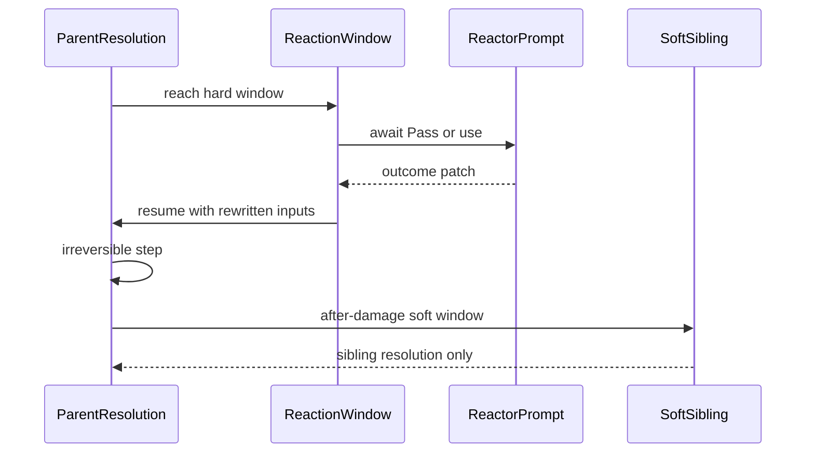

# Illusive combat engine

**Status:** Authoritative engine design (hybrid reactions)  
**Module:** `illusive-dnd-5e`  
**Last updated:** 2026-11-09  
**Product context:** [design-doc.md](design-doc.md) · content inventory: [content-inventory.md](content-inventory.md)

This document owns **how combat resolutions run**: phases, irreversibility, reaction windows, pause/resume, game-log undo, and reactions as declarations. Product goals and package scope stay in the design doc.

---

## 1. Purpose & boundaries

| Owner | Owns | Must not own |
|---|---|---|
| Illusive combat engine | ActionResolution FSM, reaction windows, economy flags, cover/OA/visibility orchestration, appliedChanges / undo, HUD explanation | Dice math inside dnd5e rolls; item authoring |
| dnd5e system | Activities, rolls, spell slots, conditions APIs | Illusive workflow phases |
| Illusive HUD | Prompts, gems, game-log UI | Rule decisions / document writes for resolutions |

**Rules baseline:** 2024, with labeled 2014 / Legacy variants. Citations live in [`src/rules/catalog.mjs`](../src/rules/catalog.mjs).

---

## 2. Layer map

```text
domain/combat/     pure FSM, OA eligibility, turn budget, game-log order
application/       resolve-activity, reaction windows, economy, prompts
foundry/           hooks, document undo, workflow persist, dnd5e use()
hud/               reaction chrome, action bar, game log presentation
```

Key files:

| Concern | Path |
|---|---|
| Phases / resolution shape | `src/domain/combat/action-state.mjs` |
| Transitions | `src/domain/combat/advance-action.mjs` |
| Start / pause / correct | `src/application/combat.mjs` |
| Attack / save / damage pipeline | `src/application/resolve-activity.mjs` |
| Single HP write path (trail + concentration + KO) | `src/application/damage-apply.mjs` → `applyDamageWithTrail` |
| Reactions (declarations, §9) + windows (protocol) | `src/content/declarations.mjs`, `src/application/reactions/window.mjs` |
| Reaction relay to the owner's client | `src/foundry/reaction-socket.mjs` |
| HUD prompt state + Pass/use settle | `src/application/reaction-context.mjs` |
| OA leave-reach | `src/application/opportunity-attack.mjs` + domain |
| Undo | `src/foundry/document-adapter.mjs` |

Shared helpers (use these; do not re-implement locally):

| Helper | Path |
|---|---|
| `tokenFromUuid`, `actorFromUuid`, `tokenForActor` (uuid-first, unlinked-safe), `tokenUuidOf` | `src/foundry/token-lookup.mjs` |
| `isHostile`, `isFriendly` | `src/domain/combat/disposition.mjs` |
| `isIncapacitated`, `hasAnyStatus`, `DEFENDER_GRANTS_ADVANTAGE` | `src/domain/combat/conditions.mjs` |
| `listActivities`, `isMeleeAttack`, `isRangedAttack`, `pickPrimarySpellActivity`, `primaryDamageType`, `isElementalType`, `isPhysicalType` | `src/domain/combat/activity-kind.mjs` |

---

## 3. ActionResolution contract

```js
{
  schemaVersion: 1,
  id, actorUuid, itemUuid, activityId,
  rulesContext,           // edition / legacy
  phase,                  // see §4
  targets[], rolls[],
  pendingDecision,        // reaction wait payload
  appliedChanges[],       // undo trail
  trace[],
  parentResolutionId,     // reaction caused by this parent
  activationType,
  economySpend,           // { before, after } for refund
  reactionWindow          // optional: { windowId, mode, resumePhase, patches }
}
```

**Events** (domain `advanceAction`): `start`, `awaitReaction`, `reactionResolved`, `attackRolled`, `saveRolled`, `damageRolled`, `recordChange`, `useCompleted`, `cancel`, `correct`.

---

## 4. Lifecycle & reaction windows

```text
created → awaiting-attack → awaiting-damage-or-save → ready-to-apply → completed
         ↘ awaiting-reaction ↗ (hard window; resumePhase restored)
                                                         ↘ cancelled | corrected
```

Named **reaction windows** sit on the parent pipeline. Mode is **hard** (parent pauses) or **soft** (sibling prompt only).

| Window id | When (parent) | Mode | May rewrite |
|---|---|---|---|
| `leave-reach` | Token would leave reach | Hard (hold move) | Allow move after OA / Pass |
| `on-cast` | Spell/cast begun; before attack/save/template drive | Hard (Ready: soft) | `cancelCast` |
| `on-attack-declared` | Attack targets known; before the attack roll | Hard (Ready: soft) | `attackDisadvantage` |
| `on-attack-hit` | Attack hit vs AC; before damage roll/apply | Hard | `rerollAttack` (keep lower), `attackPenalty`, `acBonus` |
| `on-attack-miss` | Melee attack missed (final outcome) | Soft | — (Riposte counterattack) |
| `on-save-success` / `on-save-fail` | Save rolled vs DC; before damage/effects | Hard | `rerollD20` (keep lower / keep new with advantage) |
| `on-check-success` | Check activity met its DC | Hard | `rerollD20` (keep lower) |
| `on-damage-known` | Damage totals known (weapon + riders + bonus); **before** HP write | Hard | `damageMultiplier`, `damageReduce`, `resistTypes` |
| `after-damage-applied` | HP already changed | Soft | — (Hellish Rebuke, Retaliation, Storm's Thunder) |
| `after-move` | Combatant finished a move | Soft | — (readied "move" triggers) |
| `on-fall` | dnd5e `plummet` fall damage rolled; before HP write | Hard, detached (no parent) | `damageMultiplier`, `damageReduce` |



---

## 5. Windows & irreversibility

| Step | Committed after | Hard windows before it |
|---|---|---|
| Slot / item consume via `activity.use` | Use returns | `on-cast`; a countered 2024 spell gets its slot back, never its action |
| Attack roll | `rollAttack` | `on-attack-declared` (Protection) |
| Attack hit list | Hit evaluation | `on-attack-hit` (Shield / Parry / disrupt) |
| Save / check outcome | Roll vs DC | `on-save-success`, `on-save-fail`, `on-check-success` |
| Fall damage | `applyDamageWithTrail` on the faller | `on-fall` |
| Damage totals | `rollDamage` + riders + bonus, folded per target | — |
| HP / KO / concentration | `applyDamageWithTrail` (concentration DC from HP actually lost) | `on-damage-known` |
| Retaliation prompts | Soft only | `after-damage-applied` |
| Token position (OA) | Move apply | `leave-reach` hold |

Do **not** write HP before `on-damage-known` completes. Do **not** treat soft Hellish Rebuke as able to un-apply the hit that triggered it via the window protocol (undo is separate).

---

## 6. Pause / resume protocol (hybrid)

### Hard window

1. `openReactionWindow({ parentId, windowId, baseCtx, patchCtx, detached })` collects eligible reactors (`collectWindowCandidates`): not the triggering creature (unless the declaration sets `selfTrigger`, e.g. Countercharm / Feather Fall / Slow Fall), not incapacitated, reaction unspent, the declaration's condition, `range` / `sight` vs the triggering token, the source item or the `offer` list.
2. Reactors are **grouped per creature** (one reaction each) and queued by **initiative, highest first**, then token id. A creature with any hard reaction in the window gets the hard (waiting) prompt; creatures with only soft reactions are prompted without waiting.
3. `detached: true` (falls) waits on a synthetic id without pausing a parent resolution.
4. For each reactor: `pauseParentForReaction` (parent → `awaiting-reaction`, resume phase derived from the parent's own state), then prompt.
5. Decision: **Pass** (no patch) or **use** `{ used, itemId, slotLevel, allyUuid }` → the reaction's own resolution runs (linked via `parentResolutionId`), then the declaration's steps compute the rule outcome (rolled Deflect / Cutting Words die, Counterspell save/check). `slotLevel` comes from the HUD slot picker (2014 Counterspell, Absorb Elements dice); `allyUuid` is the owner's first target other than the trigger (Silvery Barbs advantage).
6. Queue empty or `cancelCast`: `resumeParent(parentId, patches)` → `reactionResolved`, and the pipeline applies the merged patches.
7. Timeout (`reactionTimeout` setting) = Pass. The waiting side has its own grace timer (timeout + 3 s) so a disconnected owner never stalls combat.

Nested hard windows (Counterspell on a Shield cast) work: the prompt is cleared before the reaction resolves, so the inner window can prompt.

### Soft window

1. Prompt eligible reactors with `parentResolutionId` set (optional: `after-move` has no parent); the parent **does not wait** and no sibling shell is created.
2. Using the reaction creates a child resolution → game-log `kind: "reaction"` + cascade undo (children first).
3. Specs may run `beforeUse` / `afterUse` hooks around the use (Riposte spends a superiority die and queues its damage rider; Ready clears the readied action).

### Reaction leftovers (actor flags, `reactions/reaction-state.mjs`)

- `nextD20Advantage` — Silvery Barbs grant; read by the attack / check / save modifier collectors, spent by the next roll that used it, 1 minute.
- `pendingHitRiders` — Absorb Elements (first melee hit on the reactor's **next turn**: arms at that turn start, lapses at the one after) and Riposte (the counterattack's hit; dropped at the owner's next turn start).
- `readied` — Ready `{ text, trigger, itemId, activityId, rangeFeet }`; cleared at the readier's next turn start.

### Opportunity attacks

Hard hold via `preUpdateToken` + pending move stash (`leave-reach`). Uses the OA pending shell (`beginPendingReaction`).

### Multiplayer relay

Prompts appear on the **reactor owner's client** (an active non-GM owner; otherwise the client that opened the window, e.g. GM for NPCs).

1. `promptReactor(actor, activities, windowId, options)` → `module.illusive-dnd-5e` socket `{ type: "illusive-dnd-reaction", kind: "prompt", refs, options }`.
2. The owner's client shows the normal HUD prompt with `options.relayUserId`.
3. Pass / use → `{ kind: "decision", options, used, itemId, slotLevel, allyUuid }` back to the asking client.
4. The asking client runs `settleReactionPrompt` exactly as for a local decision (hard: release the wait; OA: release the held move).

API surface (application):

- `openReactionWindow(...)` → `Promise<MergedPatches>`
- `pauseParentForReaction(...)`, `resumeParent(parentId, patches)`
- `promptReactor(...)`, `settleReactionPrompt(options, decision)`
- `beginPendingReaction(...)` — OA shell only

---

## 7. Game log & undo

- Causing action stamps `parentResolutionId` / log `parentId`.
- Rows with a parent are `kind: "reaction"`.
- Undo of a parent runs **child reactions first** (`cascadeUndoOrderInTurn`), then parent `appliedChanges` + economy refund.
- Dismissed use (player closed the dialog): refund `economySpend`; parent `cancelled`.
- **Countered** (Counterspell): parent `cancelled` with `cancelReason: "countered"`; the action stays spent (RAW). 2024 refunds the spell slot; 2014 does not.
- Damage Illusive did not drive (`dnd5e.rollDamageV2` fallback) is recorded onto the active resolution so it is undoable too. Illusive-driven rolls run inside `beginOwnedResolve` so that fallback never double-applies them.
- GM `correct` / `correctLastCompleted` uses reversed `appliedChanges` (`combat.correction`).
- The log is a GM-persisted journal shared by every client, and automatic writes (over-time ticks, expiries, triggers) are on it too. See §14.

---

## 8. Online vs deferred (engines)

Synced with [content-inventory.md](content-inventory.md):

| Engine | Status |
|---|---|
| Turn budget + Extra Attack | Online |
| Weapon masteries / hit riders / auras / templates / roll mods | Online |
| Cover bake + soft ¾ GM prompt / obscurement / melee KO | Online |
| OA leave-reach hard hold | Online |
| Reaction **hard windows** (hybrid) | Online (R1–R5) |
| Reaction relay to owner clients | Online |
| Ready as deferred trigger (move / cast / attack) | Online (soft) |
| Fall damage routing + Feather Fall / Slow Fall | Online (dnd5e 6 `plummet`) |
| Save / check reaction windows | Online |
| GM write gateway + single primary writer | Online (§13) |
| Persisted, synced game-log journal | Online (§14) |
| Declared triggers (passive / soft / hard) | Online (§15), 6 shipped rules |
| Auto-fire OA | Out of scope |

---

## 9. Reactions

### 9.1 Reactions as declarations

Item reactions are prompted declarations (§15) in `src/content/declarations.mjs`:

```js
{
  id: "shield",
  match: { types: ["spell"], identifiers: ["shield"], names: [/^shield$/i] },
  declarations: [{
    id: "shield",                    // spec id, patch source and combatFx subtype
    rule: "combat.reaction.shield",  // catalog citation
    on: "isHit",                     // moment = window (Silvery Barbs lists three)
    mode: "hard",                    // "hard" | "soft"
    range: 60, sight: true,          // optional: vs the triggering creature
    selfTrigger: true,               // optional: the triggering creature may react to itself (Countercharm, falls)
    offer: "meleeWeapons",           // optional: offer these instead of the item's activities (Retaliation, Riposte)
    if: { all: [{ "self.isTarget": true }, { not: { "activity.isAttack": false } }] },
    do: [{ step: "acBonus", to: "self", value: 5 }]
  }]
}
```

Match fields: `identifiers`, `names` (accept **2024** names, e.g. Deflect Attacks / Deflect Energy, as well as 2014 Deflect Missiles), `types` (spells match only spell items, so a shield named "Shield" never offers the Shield spell), and `reactionOnly` (the 2024 Countercharm and Hunter's Defense, whose 2014 versions are actions). Do **not** trust pack-dump `activation: "action"` on spells like Shield/Counterspell — match by identifier/name.

Patches are merged by `mergePatches` (`src/application/reactions/registry.mjs`). The registry itself now holds only **Ready**, which reads the readier's flag rather than an item.

### 9.2 Window → content

**Hard (must pause parent):**

| Trigger | Window | Notes |
|---|---|---|
| Opportunity Attack | `leave-reach` | Existing domain OA |
| Counterspell | `on-cast` | Hostile, 60 ft, sight. 2024: Con save vs reactor DC, slot refunded. 2014: auto ≤ the slot it was cast with (min 3rd), else check DC 10 + level |
| Protection | `on-attack-declared` | Ally within 5 ft attacked by a seen hostile, reactor holds a shield; disadvantage on that attack |
| Shield | `on-attack-hit` | Target of the hit; `acBonus: 5`, re-check hit; a crit still hits |
| Parry (monster) | `on-attack-hit` | Melee hit on the reactor; AC bonus from "adds N to its AC", else proficiency |
| Silvery Barbs | `on-attack-hit`, `on-save-success`, `on-check-success` | 60 ft, sight; reroll, keep the lower roll; advantage to the reactor's first other target (else self) |
| Cutting Words | `on-attack-hit` | 60 ft, sight; `attackPenalty` = rolled Bardic Inspiration die |
| Countercharm (2024) | `on-save-fail` | Self or ally within 30 ft vs Charmed/Frightened effects; reroll with advantage, keep the new roll |
| Uncanny Dodge | `on-damage-known` | Attack roll by a seen attacker; halves the whole hit |
| Absorb Elements | `on-damage-known` | Attacks and saves; resistance to the elemental types; next-turn melee hit +1d6 per slot level of that type |
| Deflect Missiles / Deflect Attacks / Deflect Energy | `on-damage-known` | 1d10 + Dex + Monk level. Missiles: ranged weapon. Attacks: B/P/S. Energy: any |
| Stone's Endurance | `on-damage-known` | Reduce 1d12 + Con |
| Superior Hunter's Defense (2024) | `on-damage-known` | Resistance to the hit's types, plus until the current turn ends |
| Interception | `on-damage-known` | Ally within 5 ft hit by an attack; reduce 1d10 + proficiency |
| Feather Fall | `on-fall` (detached) | Self or other within 60 ft; no fall damage, no prone |
| Slow Fall | `on-fall` (detached) | Self; reduce by 5 × Monk level |

**Soft:**

| Trigger | Window | Notes |
|---|---|---|
| Hellish Rebuke | `after-damage-applied` | 60 ft, sight |
| Storm's Thunder | `after-damage-applied` | 60 ft; the feature's damage activity |
| Wrath of the Storm | `after-damage-applied` | 5 ft, sight, attack hits |
| Retaliation | `after-damage-applied` | Attacker within 5 ft; offers melee weapon attacks |
| Riposte | `on-attack-miss` | Melee miss within 5 ft; melee weapon attack + superiority die damage |
| Ready | `after-move` / `on-cast` / `on-attack-declared` | The readied activity, within its range, vs a hostile trigger |

**Not wired:** Redirect Attack / Split (monster) — swap or spawn logic, GM-run.

### 9.3 Multi-reactor order

When several creatures are eligible in one window: sort by **initiative, highest first** (turn order), then `token.id`. One prompt per creature listing all its eligible reactions. Patches **merge**: `damageReduce` and `attackPenalty` sum, `damageMultiplier` multiplies, `resistTypes` union (resistance never stacks with existing resistance), `cancelCast` ends the window.

### 9.4 Rules catalog ids

- `combat.economy.reaction` — spend + pause (not tracking-only)
- `combat.opportunity-attack.2024` / `.2014`
- `combat.reaction.shield`, `.counterspell`, `.hellish-rebuke`, `.uncanny-dodge`, `.absorb-elements`, `.deflect`, `.silvery-barbs`, `.cutting-words`
- `combat.reaction.parry`, `.protection`, `.interception`, `.countercharm`, `.stones-endurance`, `.superior-hunters-defense`, `.feather-fall`, `.slow-fall`, `.storms-thunder`, `.wrath-of-the-storm`, `.retaliation`, `.riposte`
- `combat.action.ready`

### 9.5 Non-goals

- Auto-fire OA without owner choice  
- Readied spells held with concentration (the slot is spent on release instead)  
- Feather Fall on extra creatures beyond the faller  
- Premade class/spell script library beyond window + `activity.use`

---

## 10. Implementation slices

| Slice | Work |
|---|---|
| **R0** | This document + design-doc pointers |
| **R1** | Parent hard pause/resume + `openReactionWindow` / `resumeParent` |
| **R2** | Hard `on-attack-hit`: Shield, Silvery Barbs, Cutting Words |
| **R3** | Hard `on-damage-known`: Uncanny / Absorb / Deflect*; remove double prompt |
| **R4** | Hard `on-cast` Counterspell cancel + refund |
| **R5** | Soft Hellish Rebuke; registry + 2024 Deflect aliases |
| **R6** | Pack expand: Stone's Endurance, Hunter's Defense, Interception, Protection, Parry, Riposte, Retaliation, Storm's Thunder, Wrath of the Storm, Countercharm |
| **R7** | Save/check windows (Silvery Barbs + ally advantage), slot level in decisions, Absorb rider |
| **R8** | Ready triggers; dnd5e 6 fall routing + Feather Fall / Slow Fall |

### Verification

- Pass → parent resumes unchanged (`test/reaction-relay.test.mjs`)
- Relayed decision settles on the asking client (`test/reaction-relay.test.mjs`)
- Eligibility: range, sight, incapacitated, self, initiative order (`test/reaction-relay.test.mjs`)
- Shield miss / crit still hits; Silvery Barbs keeps lower; Cutting Words penalty; Counterspell slot refund (`test/attack-pipeline.test.mjs`)
- One HP write per hit with riders + bonus; Uncanny halves riders too (`test/attack-pipeline.test.mjs`)
- Concentration from HP actually lost; immunity skips the check (`test/concentration-save.test.mjs`)
- Every reaction declaration: window and mode, Shield matches the spell only, Deflect variants, Cutting Words die, Silvery Barbs on attacks / saves / checks with the journaled advantage grant, Protection and Interception near the attacked ally, Absorb Elements types and rider, Hunter's Defense lingering resistance, Counterspell editions, Countercharm edition gate, Feather / Slow Fall, Riposte spend and rider on use (`test/reaction-declarations.test.mjs`)
- Ready offer + range, rider arming, advantage grant on saves, fall matching (`test/reactions-expansion.test.mjs`)
- OA still holds move; game-log cascade undo; regression suite green

---

## 11. Coverage

Status: **covered** = automated + tested; **partial** = automated with a known gap; **needed** = not built.

### Covered

1. Hard pause/resume of the parent for Shield, Counterspell, Silvery Barbs, Cutting Words, Uncanny Dodge, Absorb Elements, Deflect (all variants).
2. Soft Hellish Rebuke after damage, linked to the parent for log/undo.
3. Reaction prompts on the owning player's client (hard, soft, OA), with disconnect fallback.
4. One damage write per hit (weapon + Smite/Sneak/Hex + passive riders + Rage/GWM), all on the undo trail.
5. Concentration DC from HP actually lost after immunity/resistance.
6. Hex / Hunter's Mark only on the marked creature; once-per-turn passive riders only on the first creature hit.
7. Graze / Cleave mastery damage on the undo trail (Cleave goes through the damage window).
8. Counterspell: action stays spent; 2024 slot refund (dnd5e 6 consumption deltas → `Activity#refund`); 2014 counter level from the slot picker.
9. Non-driven damage (`rollDamageV2` fallback) recorded on the active resolution; driven rolls never double-apply.
10. Silvery Barbs on attacks, saves, and checks, with the advantage grant consumed by the next d20 roll.
11. Absorb Elements next-turn melee rider; Riposte superiority die.
12. Pack reactions in §9.2 (Stone's Endurance, Hunter's Defense, Interception, Protection, Parry, Riposte, Retaliation, Storm's Thunder, Wrath of the Storm, Countercharm).
13. dnd5e 6 falls: damage goes to the creature that fell (not the last targets), prone on damage, Feather Fall / Slow Fall window.
14. Players never write documents they don't own: the write gateway routes those writes to the active GM (§13).
15. Turn ticks, special durations, aura sync and combat-end expiry run once (primary writer), not once per client.
16. Game log persisted on the combat and synced to every client; undo cascades across turns through `dependsOn`, and is blocked while a hard window waits (§14).
17. Declared triggers with six shipped rules: Blur, Protection from Evil and Good, Armor of Agathys, Heavy Armor Master (2014 + 2024), Dark One's Blessing, Defensive Duelist (§15).
18. Reaction prompts queue per client; hard prompts go ahead of soft ones, and none overwrite each other.

### Partial

1. Soft-window prompts relay to the owner but do not hold anything if the owner is offline (by design: the parent never waits).
2. Ready: a readied spell spends its slot on release (no concentration hold); "something else" triggers stay manual.
3. Protection 2024: only the triggering attack gets disadvantage (the lingering version is manual).
4. Feather Fall covers the faller only.
5. Check reactions fire for Illusive-driven check activities only; free checks from the HUD drawer still consume a Silvery Barbs grant but open no window.

### Needed

1. Live multi-client playtest of the relay, the gateway and the journal (unit-tested only).
2. Monster Redirect Attack / Split.
3. Porting hit riders, masteries, auras and over-time onto declarations (reactions are ported; these still run as code).

Full list of implemented and planned features: [feature-status.md](feature-status.md).

---

## 12. dnd5e 6 / Foundry 14 compatibility

| Area | dnd5e 6 / Foundry 14 behaviour | Illusive |
|---|---|---|
| `activity.use()` | Resolves `undefined` on dismiss / refusal / failed consume | Treated as cancel |
| Upcast | `usage.spell.slot` is a slot key (`spell3`, `pact`) | `spellSlotKeyForLevel` |
| Consumption | Deltas on `message.system.deltas.actor`; `Activity#refund` | Counterspell refund uses both |
| Hooks | `dnd5e.useActivity` removed; death saves carry `details.outcome` | Listeners removed / ported |
| Templates | `MeasuredTemplateDocument` is a Region shim; `AbilityTemplate` deprecated | Placer creates Regions (incl. emanations); auto-saves on `createRegion` |
| Region flags | `flags.dnd5e.activity` / `origin` = token | Source lookup prefers `activity` |
| Data paths | `movement.speeds.*`, `senses.ranges.*`, `rolls.ability.save.bonus`, AE `type: "add"` | `actor-paths.mjs` readers; effects write the new keys |
| Concentration | dnd5e prompts on HP loss itself | Illusive notes the DC instead of rolling twice |
| Falling | `falling` status + `TokenDocument#plummet` posts fall damage | Routed to the faller + `on-fall` window |
| Queries | `CONFIG.queries[name]` + `User#query(name, data, { timeout })` | GM write gateway and journal (§13, §14) |
| `combatTurnChange` | Fires on every client | Only the primary writer acts on it |

---

## 13. GM authority & the write gateway

Players never write documents they don't own. Every combat write goes through `src/foundry/write-gateway.mjs`:

| Op | Used for |
|---|---|
| `update` | Item uses, token pushes, effect durations |
| `setFlag` / `unsetFlag` | Reaction state, Help, Vex / Sap, trigger once-per-turn |
| `create` | Active effects (conditions, auras, round effects) |
| `delete` | Expired effects, ended concentration on an unowned actor |
| `applyDamage` | All HP writes (`isDelta`; returns prior / next HP) |
| `toggleStatus` | Prone, unconscious, statuses from triggers |

1. If this user owns the document (or is the GM), the write runs locally. Otherwise it goes to the active GM as the `illusive-dnd-5e.write` query, and the GM runs it.
2. Writes to one document are queued, so two saves landing together never interleave a flag write. Item and effect writes queue on their parent actor.
3. Every op returns `undo` records (shapes are in the file header). Undo goes back through the gateway with `isUndo: true`.
4. **Primary writer** (`src/foundry/gm-query.mjs` `isPrimaryWriter()`): the active GM, else the lowest-id active player. Only it runs turn-change ticks, special durations, aura sync, combat-end expiry and turn-moment triggers.
5. Movement is logged only on the client that moved the token, and forced moves (`illusiveDndForced`) are not logged as movement.
6. NPC reactions prompt the GM, not the attacking player.

## 14. Game-log journal

The log is one list of turns, replicated on every client and persisted by the GM on `combat.flags.illusive-dnd-5e.gameLog` (`{ v: 1, turns }`, debounced 150 ms).

1. Every change to the log is an op from `applyLogOp` (`src/domain/combat/game-log.mjs`): `push`, `amend`, `remove`, `popTurn`, `clear`. All are idempotent (entry ids are `log:<client>:<seq>`), so a replayed op never duplicates a row.
2. A player applies its op locally, sends it to the GM (`illusive-dnd-5e.journal` query), and keeps it pending. When the persisted log arrives (`updateCombat`), it is hydrated and pending ops are re-applied on top.
3. **Automatic writes are journaled.** `journalChanges({ changes, label, resolutionId, dependsOn })` puts undo records onto the live resolution (`recordChange`), onto its completed row, or onto a new `system` row. Over-time ticks, expiring effects, mastery side effects and triggers all use it.
4. **Dependencies.** A row's `dependsOn` lists the rows it follows from: an over-time tick depends on the row that created its effect (`entriesForEffects`). `collectUndoCascade` undoes the target's reactions and every dependent row in any turn, newest first, target last.
5. **HP undo is a delta.** If HP changed since the write, undo applies the inverse change (clamped to 0..max) instead of restoring a stale exact value.
6. Undo is refused while a hard reaction window is waiting, and undoing a row dismisses its pending soft prompts.

## 15. Declared triggers

Rules as data instead of code. Files:

| Path | Role |
|---|---|
| `src/domain/triggers/moments.mjs` | Moment catalog; each wired moment maps 1:1 to a reaction window |
| `src/domain/triggers/conditions.mjs` | `evaluateCondition` (`all` / `any` / `not`, `eq ne gt gte lt lte in has hasAny exists`) |
| `src/domain/triggers/steps.mjs` | Step library: patch steps and write steps, each with its undo kind |
| `src/domain/triggers/declarations.mjs` | Schema + `declarationErrors` |
| `src/domain/triggers/formula.mjs` | `@ref` values and arithmetic without Foundry |
| `src/application/triggers/index.mjs` | Per-actor declaration index, grouped by moment |
| `src/application/triggers/facts.mjs` | Lazy facts for conditions (`self.*`, `trigger.*`, `relation.*`, `activity.*`, `damage.*`, `damaged.*`) |
| `src/application/triggers/derived.mjs` | Formula values dnd5e keeps in scale tables or text (`@bardicDie`, `@parryBonus`, …) and `offer` lists |
| `src/application/triggers/engine.mjs` | Runs declarations; turns prompted ones into reaction specs |
| `src/content/declarations.mjs` | Shipped rules, including every item reaction (§9.1) |

**Declaration:**

```js
{
  id: "armor-of-agathys",
  rule: "combat.trigger.armor-of-agathys",
  on: "isHit",                            // or a list of moments
  mode: "passive",                        // "passive" | "soft" | "hard"
  if: { all: [{ "self.isTarget": true }, { "activity.isMelee": true }, { "self.hp.temp": { gt: 0 } }] },
  range: 60, sight: true, once: "turn",   // optional
  edition: "2024",                        // optional; matched against the source item's rules version
  do: [{ step: "damage", to: "trigger", value: "5 * @sourceLevel", damageType: "cold" }]
}
```

**Moments:**

| Moment | Window |
|---|---|
| `attackDeclared` | `on-attack-declared` |
| `isHit` / `isMissed` | `on-attack-hit` / `on-attack-miss` |
| `damageKnown` / `isDamaged` | `on-damage-known` / `after-damage-applied` |
| `castsSpell` | `on-cast` |
| `savedSave` / `failedSave` / `checkSucceeded` | `on-save-success` / `on-save-fail` / `on-check-success` |
| `falls` / `moves` | `on-fall` / `after-move` |
| `turnStart` / `turnEnd` | Turn change (primary writer) |

**Sources**, per actor: shipped content matched by item identifier, item name or active effect name; `flags.illusive-dnd-5e.triggers` on an item; `flags.illusive-dnd-5e.triggers` on an applied effect. Invalid declarations are skipped with one console warning.

**Modes:**

1. **Passive** runs inside `openReactionWindow` before anyone is prompted, whether or not reaction pausing is on. Its patches are merged with the reactions' patches.
2. **Soft / hard** become reaction specs (`declarationSpecsForWindow`, id = declaration id), so they share the prompt, the wait and the pause. They need a source item; the prompt offers its activities (or the `offer` list), and using one spends the reaction. Hard steps run when the paused action resumes; soft steps run before the offered activity. A prompted declaration may have no steps when the activity is the whole effect (Hellish Rebuke). An unmeasurable distance blocks a passive rule but still offers a prompt.

**Steps:**

| Kind | Steps | Undo |
|---|---|---|
| Patch | `advantage`, `disadvantage`, `attackBonus`, `attackPenalty`, `acBonus`, `damageReduce`, `damageMultiplier`, `resist`, `reroll` (the attack on a hit, else the d20; `keep`, `advantage`), `cancelCast`, `counterspell` | Only exists inside the moment |
| Write | `damage`, `heal`, `tempHp`, `applyStatus`, `removeStatus`, `applyEffect`, `endEffect`, `setFlag`, `spendUses` (`item` pattern for another item's uses), `grantAdvantage`, `hitRider`, `resistEffect` | Gateway record, journaled |
| Note | `note` | Irreversible (chat) |

`to` picks creatures: `self`, `trigger`, `target`, `targets`, `damaged`, `ally` (the reactor's chosen ally, else self), `nearTarget` (the attacked creature within 5 ft). `types` is a list, `"trigger"` (every damage type of the moment) or `"elemental"`. Values are numbers or formulas (`@prof`, `@sourceLevel`, `@slotLevel`, `@monkLevel`, `@bardicDie`, `@superiorityDie`, `@parryBonus`, any roll-data path; dice post a chat roll, and count as their average without Foundry).

**Undo:** a declaration's writes are journaled onto the causing resolution. One that comes from an active effect also depends on the row that created that effect, so undoing the cast undoes what the effect did since. `once` is a flag write, so undo restores it too.

**API:** `game.modules.get("illusive-dnd-5e").api.triggers`: `validate`, `declarationsOn(actor)`, `refresh()`, `runPassiveTriggers`, `MOMENTS`, `STEPS`, `CONTENT`.

**Not yet:** prompted declarations sourced from effects only (no item), turn moments for soft/hard modes, and the moments from the roadmap that have no window yet (`preAttackRoll`, `isTargeted`, `gainsCondition`, area enter/leave, `rest`).

## 16. Efficiency

1. **Index first.** A moment asks each actor's declaration index for that moment; an actor with nothing listening costs one map lookup and is skipped before any distance or sight work. The index rebuilds only for the actor whose item, effect or data changed.
2. **Lazy, cached facts.** `createMomentScope` / `candidateContext` (`src/application/reactions/candidates.mjs`) compute distance, sight and nearest-ally lazily and cache each pair for the moment. The reaction window and the trigger engine share them.
3. **One aura sync.** Aura sync runs only on the primary writer and is debounced (120 ms), so a burst of token and actor hooks triggers one sync.
4. **Prompt queue.** One prompt shows per client at a time; the rest wait in a queue, hard before soft, and stale entries are dropped.

### Verification

- Gateway routing, GM handler, HP records, queue order, primary writer (`test/write-gateway.test.mjs`)
- Journal op idempotency, cross-turn cascade, effect → row lookup (`test/game-log-journal.test.mjs`)
- Conditions, validation, shipped content schema + citations, formulas, Blur, Armor of Agathys journaled with `dependsOn`, Heavy Armor Master editions, Dark One's Blessing, once per turn, Defensive Duelist as a hard spec (`test/triggers.test.mjs`)
- Prompt queue (`test/reaction-context.test.mjs`), HP delta undo (`test/document-undo-hp.test.mjs`)
