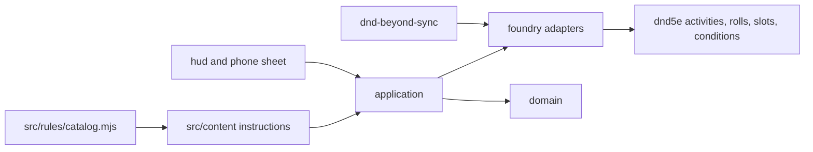
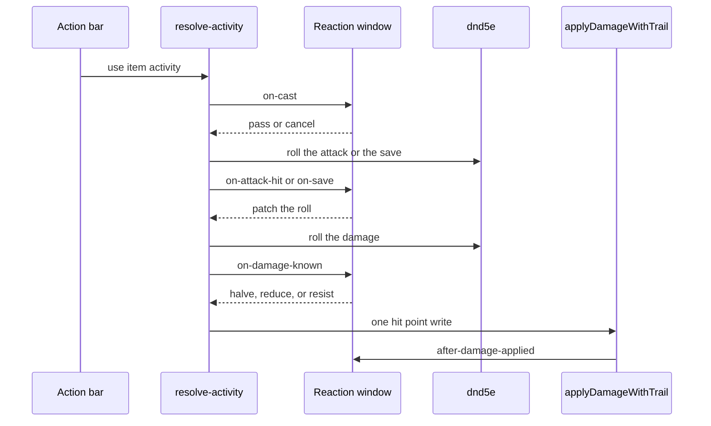
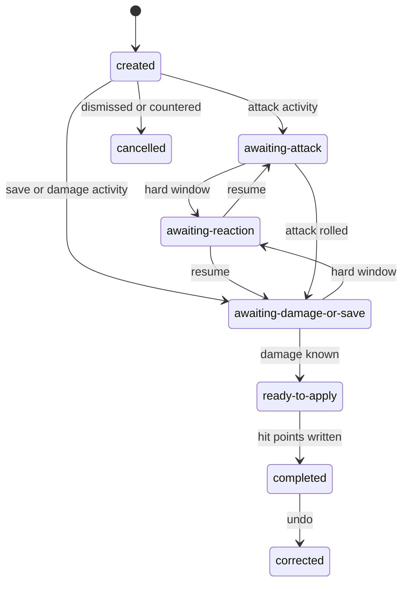
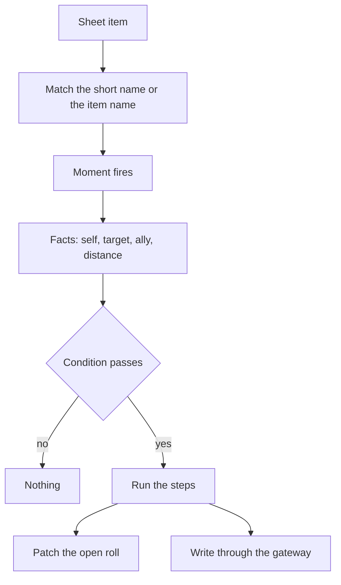
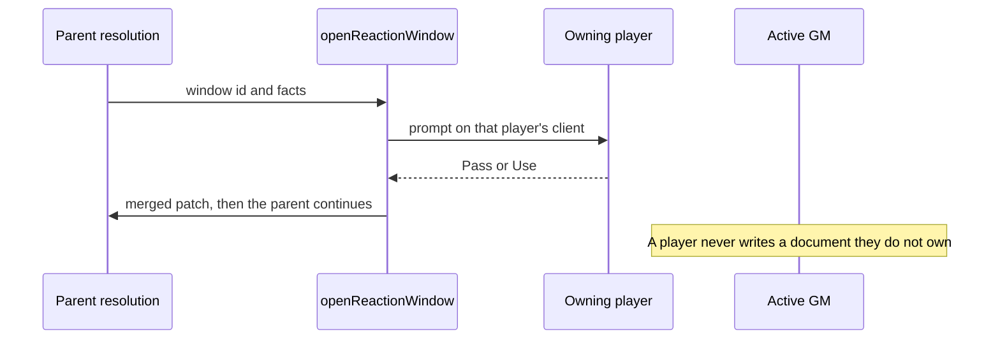

# Engine

**Module:** `illusive-dnd-5e` 0.2.0  
**Foundry:** 14.370 · **dnd5e:** 6.0.0–6.0.6  
**Rules:** 2024. A 2014 item is labeled on that item.

Illusive owns the combat loop. dnd5e owns the dice, the activity, the spell slot, and the condition. This module does not fork the system. `module.json` conflicts with Midi-QOL and with `dnd5e-combat`.

A spell or feature that is still missing is another instruction in `src/content/`. The steps that run it are already here.

## What each layer owns



| Folder | Owns | Does not own |
| --- | --- | --- |
| `src/domain/` | Pure checks: hit, cover, budget, moments, step shapes, mastery plan | Foundry documents, dice, the DOM |
| `src/application/` | Resolve an activity, open a reaction window, apply damage, move a token, run an instruction | Markup |
| `src/foundry/` | Hooks, the GM write gateway, the reaction socket, document undo | A second copy of a rule |
| `src/content/` | The instruction for a named spell or feature | A new dice pipeline |
| `src/rules/` | The citation for each instruction | The procedure |
| `src/hud/`, `src/tabletop/`, `src/animation/` | The bar, the tracker, the phone, the effect | Hit points |
| `src/dnd-beyond-sync/` | Live Beyond reads and writes. The relay sees ciphertext only | Combat rules |

The HUD does not call `setFlag`, `applyDamage`, or `activity.use`. A click goes through `src/application/`.

## One activity



`src/application/resolve-activity.mjs` is that sequence. Every hit point write goes through `applyDamageWithTrail` in `src/application/damage-apply.mjs`, then the GM write gateway in `src/foundry/write-gateway.mjs` when the player does not own the document.

## Resolution states



The phase strings in `src/domain/combat/action-state.mjs` are `created`, `awaiting-attack`, `awaiting-reaction`, `awaiting-damage-or-save`, `ready-to-apply`, `completed`, `cancelled`, and `corrected`. The diagram uses those eight. A save and a damage roll share `awaiting-damage-or-save`.

The record is an `ActionResolution`: phase, targets, rolls, the undo list, the parent id when this roll is a reaction, and the window patch. Events live in `src/domain/combat/advance-action.mjs`. Start, pause, and correct live in `src/application/combat.mjs`.

A hard window sets the parent to `awaitingReaction` until Pass or Use. A soft window prompts and does not wait. The default mode on an instruction is hard. Ready is soft. The miss window opens before the hit is frozen, so an instruction can turn that miss into a hit.

## An instruction



An instruction is data, not a new file per spell.

```js
{
  id: "shield",
  match: { types: ["spell"], identifiers: ["shield"], names: [/^shield$/i] },
  declarations: [{
    id: "shield",
    rule: "combat.reaction.shield",
    on: "isHit",
    mode: "hard",
    do: [{ step: "acBonus", to: "self", value: 5 }]
  }]
}
```

`match.identifiers` is the short name Foundry stores on the item (`misty-step` for Misty Step). `match.names` is the import fallback. `match.effects` matches an effect name, which is how Sanctuary avoids warding every cleric who prepared the spell. `rule` is a key in `src/rules/catalog.mjs`. The declaration `note` is the sentence the catalog shows.

Shipped instructions are `src/content/declarations.mjs`, which spreads `src/content/phase-packs.mjs` and `src/content/phase-packs-rest.mjs`. The runner is `src/application/triggers/engine.mjs`. Several moments can share one window. `momentsForWindow` in `src/domain/triggers/moments.mjs` returns every moment for that window.

### Moments

35 moments. A blank window means the moment is published by the turn, the rest, or the feature use, not by a reaction window.

| Window | Moments |
| --- | --- |
| `on-attack-declared` | attackDeclared, isAttacked, preAttackRoll, allyAttacks, enemyAttacks |
| `on-targeted` | isTargeted |
| `on-attack-hit` | isHit, allyIsHit, enemyAttacked |
| `on-attack-miss` | isMissed |
| `on-pre-damage` | preDamageRoll |
| `on-damage-known` | damageKnown |
| `after-damage-applied` | isDamaged, allyIsDamaged |
| `on-cast` | castsSpell |
| `on-save-success` | savedSave |
| `on-save-fail` | failedSave |
| `on-check-success` | checkSucceeded |
| `on-fall` | falls |
| `after-move` | moves |
| `on-leave-reach` | leavesReach |
| `on-enter-reach` | entersReach |
| none | usesFeature, hitDamage, weaponMastery, aura, turnStart, turnEnd, startOfTurn, endOfTurn, gainsCondition, disengages, enemyDisengages, rest, enter |

### Steps

A step either patches the roll that is already open, or writes a document. Patches merge in `src/application/reactions/registry.mjs`. Writes go through the gateway. The step ids are the keys of `STEPS` in `src/domain/triggers/steps.mjs`:

`advantage`, `disadvantage`, `attackBonus`, `attackPenalty`, `acBonus`, `damageReduce`, `damageMultiplier`, `halve`, `miss`, `ward`, `uncrit`, `intercept`, `evade`, `connect`, `reroll`, `cancelCast`, `counterspell`, `resist`, `bonusDamage`, `portent`, `legendaryResistance`, `redirect`, `grantAction`, `grantReaction`, `freeReaction`, `budget`, `grantMove`, `teleport`, `swap`, `push`, `pull`, `slayBelow`, `damage`, `heal`, `tempHp`, `applyStatus`, `removeStatus`, `applyEffect`, `endEffect`, `setFlag`, `spendUses`, `grantAdvantage`, `hitRider`, `resistEffect`, `save`, `zone`, `moveZone`, `aura`, `grapple`, `contest`, `control`, `metamagic`, `wildShape`, `inspiration`, `layOnHands`, `recharge`, `split`, `mark`, `repeatSave`, `endOnAction`, `lingeringDisadvantage`, `ignite`, `restoreSlot`, `pendingDie`, `chooseType`, `veil`, `note`.

`setFlag` takes a number or a formula. Omitting `value` stores true. `value: true` is rejected.

## Who is asked, and what cannot be undone



Reactors are grouped per creature, one reaction each, highest initiative first. The prompt is a socket message to the owner. An NPC prompt goes to the active GM. A timeout is a Pass. A disconnected owner does not freeze a hard window past the grace timer.

Committed, in order:

| After this | The window that can still change it |
| --- | --- |
| `activity.use` spends the slot | `on-cast`. A countered 2024 spell gets the slot back. The action stays spent |
| Attack roll | `on-attack-declared` |
| Hit list | `on-attack-hit`, then `on-attack-miss` before the hit is frozen |
| Save or check | `on-save-success`, `on-save-fail`, `on-check-success` |
| Damage total | `on-damage-known` |
| Hit points | none. `after-damage-applied` can retaliate. It cannot un-apply the hit |
| Token position | `on-leave-reach` holds the move until the opportunity attack is taken or passed |

Undo of a parent undoes its reactions first. The game log is stored on the combat by the GM. Turn ticks, aura copies, and effect expiry run on one client, the active GM, else the lowest-id active player.

## Turn budget

`src/application/economy.mjs` tracks action, bonus, reaction, and the flags `dashed`, `disengaged`, and `dodging`. `src/foundry/combat-turn.mjs` resets that budget on `combatTurnChange`. After the reset, an effect named Haste adds one action, and an item whose short name is `reactive` adds one reaction. Those two are not also granted by a turn-start instruction.

Leaving reach provokes unless the creature has the disengage status, the disengaged budget flag, Flyby with a fly speed, or `freeMoveFeet` still above 0. A push from this module does not provoke.

## Areas, light, and masteries

A zone instruction places a filled circle. Wall of Force and Wall of Stone are 10-foot circles centered on the caster and block entering and leaving. Forcecage is the same at 20 feet. They are not a wall line and not a cage of bars. Antimagic Field cancels a spell cast inside it. The slot is already spent. Globe of Invulnerability drops targets inside it for a spell of level 1 through 5. Cantrips are not warded.

`src/content/masteries.mjs` lists Cleave, Graze, Nick, Push, Sap, Slow, Topple, and Vex. `src/application/mastery.mjs` applies them after the hit or the miss. dnd5e shows the name on the attack dialog and does not apply the effect.

Night Spirit and Skulker read the light already recorded on the scene. No recorded lights means the status does not change.

## D&D Beyond

`src/dnd-beyond-sync/` is the only folder that knows Beyond's payload. Combat reads Foundry actors. The live socket is the game log. A sheet edit arrives as `character-update`, then a character read. A Beyond roll becomes a Foundry chat roll. A long rest and a short rest write back. The transport is the vendored relay. Nothing outside the module folder has to be started.

## Not an instruction

These four are outside the steps above.

| Behavior | What happens today |
| --- | --- |
| A second plane | Blink and Etherealness set the ethereal status. The token stays on this scene |
| A door | Knock and Arcane Lock do not change a lock |
| A wall line or a cage of bars | Wall of Force, Wall of Stone, and Forcecage are circles |
| A teleport to a point you pick | Dimension Door and the other six teleport spells use dnd5e's Teleport button. Misty Step moves you to 5 feet from the selected creature when that space is within 30 feet |
| A creature this module places | 34 spell items have a summon activity. dnd5e places that profile. This module does not create the actor |
